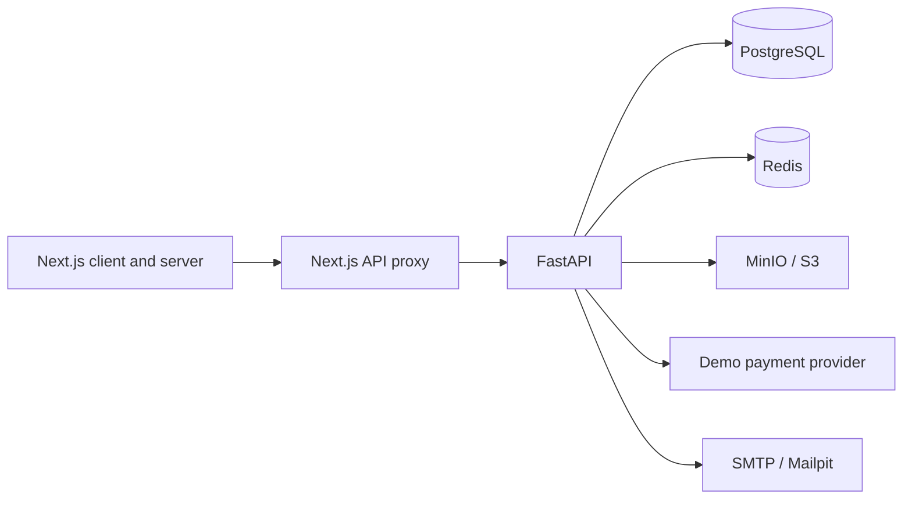

# Ticketing Demo

A full-stack application for managing the complete ticketing lifecycle: events, sessions, sale groups, checkout, PDF ticket generation, QR-based access control, and operational administration.

This is a portfolio edition. It preserves the architecture and functional workflows of the project, but does not contain credentials, data, Git history, or configuration from the private application.

## Features

- Public catalog with an event carousel and session listings.
- Registration, authentication, account recovery, and guest checkout.
- Temporary stock reservations and a self-contained demo checkout.
- PDF tickets with unique reference numbers and QR codes.
- Buyer profile and purchased-ticket downloads.
- Event, session, sale group, and ticket type management.
- Review, approval, publishing, and unpublishing workflows.
- Validation stations, device activation, and QR scanning.
- Local email delivery through Mailpit.
- Redis rate limiting and local S3-compatible storage with MinIO.

## Technology Stack

| Area | Technologies |
| --- | --- |
| Frontend | Next.js 16, React 19, strict TypeScript, CSS Modules, React Hook Form |
| Backend | FastAPI, SQLAlchemy 2, Pydantic 2, Alembic |
| Data | PostgreSQL, Redis, MinIO/S3 |
| Integrations | SMTP, ReportLab, QRCode, S3-compatible storage |
| Quality | Pytest, Vitest, ESLint, TypeScript, GitHub Actions |
| Local environment | Docker Compose |

## Architecture



Next.js acts as the only browser-facing origin. FastAPI owns the business rules, SQLAlchemy handles persistence, and Alembic maintains the versioned database schema.

## Complete Docker Setup

### Requirements

- Docker Desktop with Docker Compose.
- Available ports: `5173`, `8000`, `5432`, `6379`, `8025`, `9000`, and `9001`.

### 1. Prepare the environment

From the repository root, using PowerShell:

```powershell
Copy-Item .env.example .env
```

On Linux or macOS:

```bash
cp .env.example .env
```

The `.env` file is ignored by Git. The template only contains local demonstration credentials.

### 2. Build and start the application

```powershell
docker compose -f infra/docker-compose.yml up -d --build
```

The first startup may take several minutes. Docker builds the frontend and backend images, applies every migration, and creates six demo events with between one and six sessions each.

Check service status and logs:

```powershell
docker compose -f infra/docker-compose.yml ps
docker compose -f infra/docker-compose.yml logs -f ticketing-backend ticketing-frontend
```

All primary services should report `running` or `healthy`.

### 3. Open the services

| Service | URL |
| --- | --- |
| Application | http://localhost:5173 |
| Swagger API documentation | http://localhost:8000/docs |
| Mailpit inbox | http://localhost:8025 |
| MinIO console | http://localhost:9001 |

Demo administrator credentials:

```text
Email: admin@ticketing-demo.com
Password: TicketingDemo2026!
```

MinIO credentials:

```text
User: minioadmin
Password: minioadmin
```

The administrator can create promoters and review sessions. Buyers can register with any valid email address. Password recovery messages and ticket emails appear in Mailpit, so no real email is sent.

## Demo Purchase Flow

The public edition includes a self-contained payment provider so the complete purchase flow can be evaluated without external credentials:

1. Open a published event and select one or more tickets.
2. Continue with an authenticated buyer or complete the guest form.
3. Review the reservation and continue to checkout.
4. Confirm the purchase on the demo payment screen.
5. Download the generated PDF and inspect the delivery email in Mailpit.

No card details are requested and no real charge is created. Reservations, stock conversion, ticket generation, QR codes, PDF delivery, and buyer access remain functional.

## Stopping and Restarting

Stop the application while preserving database and image data:

```powershell
docker compose -f infra/docker-compose.yml down
```

Start it again:

```powershell
docker compose -f infra/docker-compose.yml up -d
```

Completely recreate the demo data:

```powershell
docker compose -f infra/docker-compose.yml down -v
docker compose -f infra/docker-compose.yml up -d --build
```

`down -v` removes only the local volumes owned by this portfolio edition.

## Automated Verification

Frontend:

```powershell
Set-Location ticketing-frontend
npm ci
npm run typecheck
npm run lint
npm test
npm run build
```

Backend with an isolated temporary PostgreSQL database:

```powershell
docker compose -p ticketing-demo-test -f infra/docker-compose.test.yml up --abort-on-container-exit --exit-code-from backend-test
docker compose -p ticketing-demo-test -f infra/docker-compose.test.yml down -v
```

GitHub Actions runs migrations, backend and frontend tests, OpenAPI contract verification, type checking, linting, and the production build on every push and pull request.

Run the publication boundary check separately with:

```powershell
python scripts/check_public_repository.py
```

## Troubleshooting

- If a port is already in use, stop the other application or change the corresponding mapping in `infra/docker-compose.yml`.
- If the demo credentials changed, run the complete `down -v` reset to regenerate the database.
- If the backend is not ready, inspect `docker compose -f infra/docker-compose.yml logs ticketing-backend`.
- After changing `.env`, recreate the affected service so it reloads its environment variables.

## Documentation

- [Functional workflows](docs/frontend-flows.md)
- [Alembic migrations](docs/alembic-local.md)
- [Public edition boundaries](docs/public-edition.md)
- [Security policy](SECURITY.md)

## Scope

This code is published for technical evaluation and portfolio review. Live payment integration, production infrastructure, private deployment configuration, operational data, and the private repository history are intentionally excluded. See [Public edition boundaries](docs/public-edition.md) for the exact scope.
