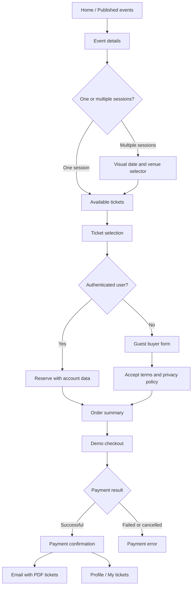
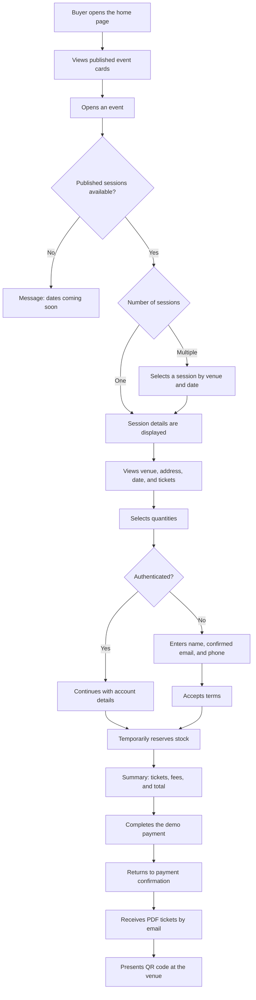
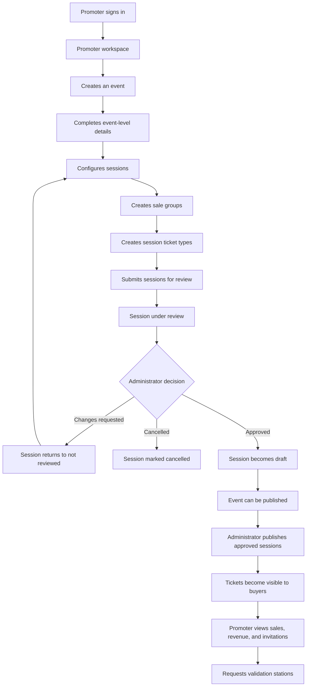
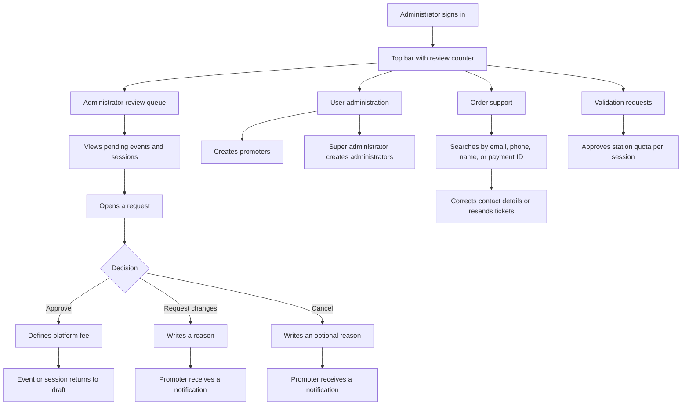
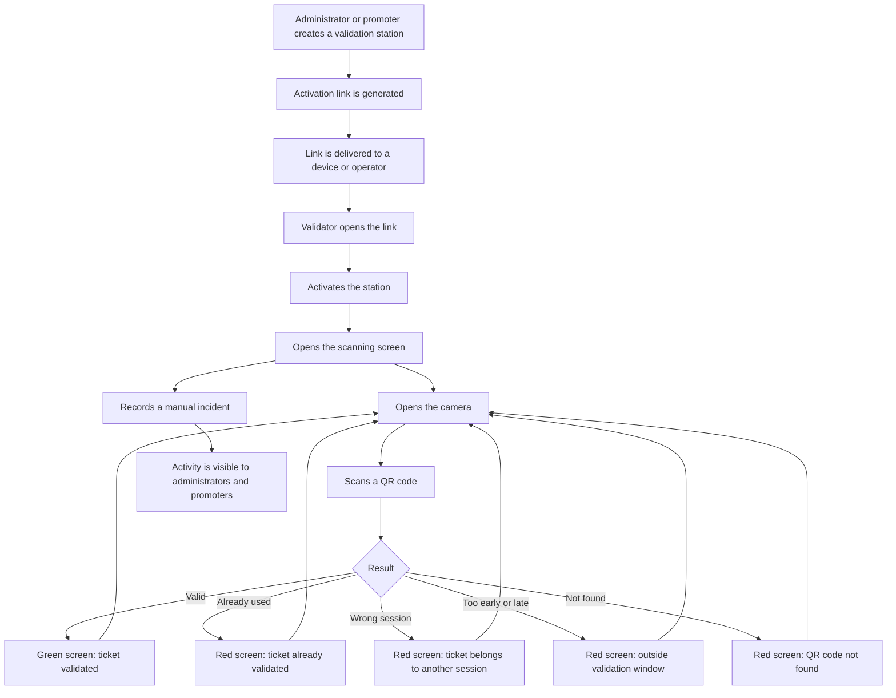
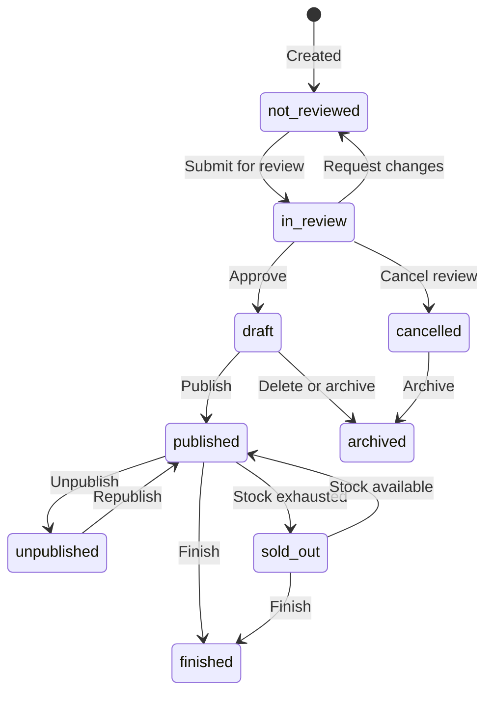

# Frontend Application Workflows

This document summarizes the current user journeys from the frontend perspective. It is intended to present the product and help design and engineering understand which screens exist, which decisions each role makes, and where the most important UX moments occur.

## 1. Main Navigation Map

## 2. Buyer Workflow

### Affected Screens

- `/`: published event listing.
- `/events/:eventId`: public event details.
- `/checkout/:orderId`: order summary and demo payment handoff.
- `/payment/demo`: self-contained payment confirmation.
- `/payment/success`: payment confirmation.
- `/payment/error`: failed or cancelled payment.
- `/profile`: account details.
- `/my-tickets`: purchased-ticket search and downloads.

## 3. Promoter Workflow

### Visible UX Rules

- While a session is under review, the promoter cannot edit it.
- Management information appears progressively: less before approval and more after publication.
- High-impact actions require confirmation: publishing, unpublishing, finishing, deleting, and cancelling a review.
- Finished sessions appear dimmed, at the end of the list, and without sales actions.
- Only administrators publish event and session content.

## 4. Administrator Workflow

### Affected Screens

- `/admin/reviews`: event and session review queue.
- `/admin/users`: users, promoters, administrators, and order support.
- `/admin/validation-requests`: validation-station requests.
- `/events/:eventId/manage`: complete event management.
- `/events/:eventId/manage/sessions/:sessionId`: session details and management.

## 5. Validator Workflow

### Affected Screens

- `/validator/activate`: station activation.
- `/validator/scan`: recurring QR scanning.
- `/validation-stations/:stationId/activity`: activity for a specific station.

## 6. Main Status Lifecycle

## 7. Key UX Considerations

- The session selector presents venue, date, and time visually rather than showing only a date.
- When only one session exists, no selector is displayed.
- The address behaves as a link to Google Maps.
- The order summary stays simple: tickets, service fees, and total.
- Buying and validation receive absolute priority on mobile through large controls, legible text, and forms without clipping.
- Dangerous administrative actions use clear confirmation modals rather than native alerts.
- Statuses are clearly labelled and visually prioritized: under review, draft, published, finished, and cancelled.
- Loading and empty states preserve layout stability and avoid unnecessary shifts.
